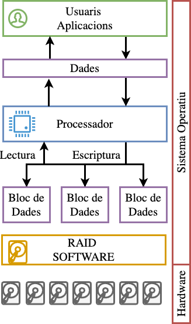
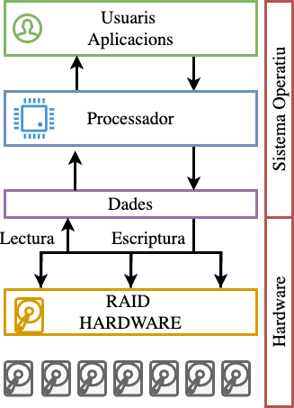
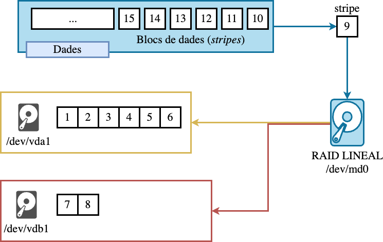
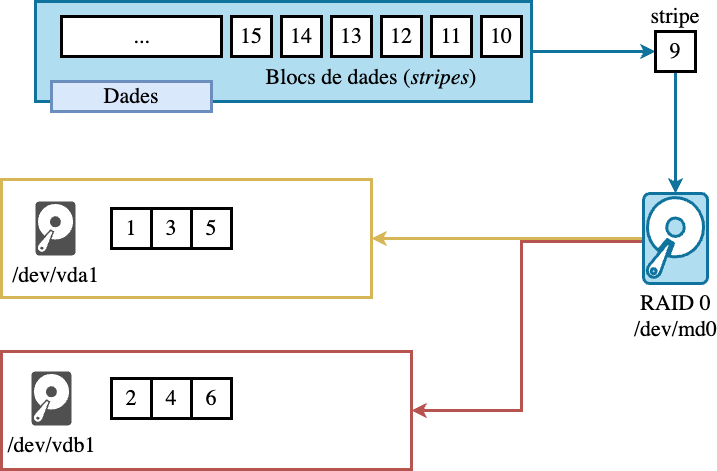
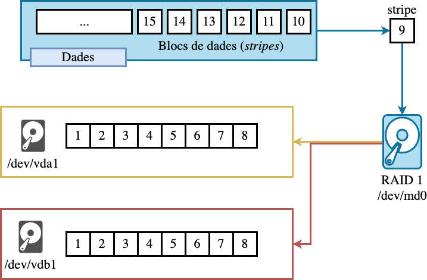
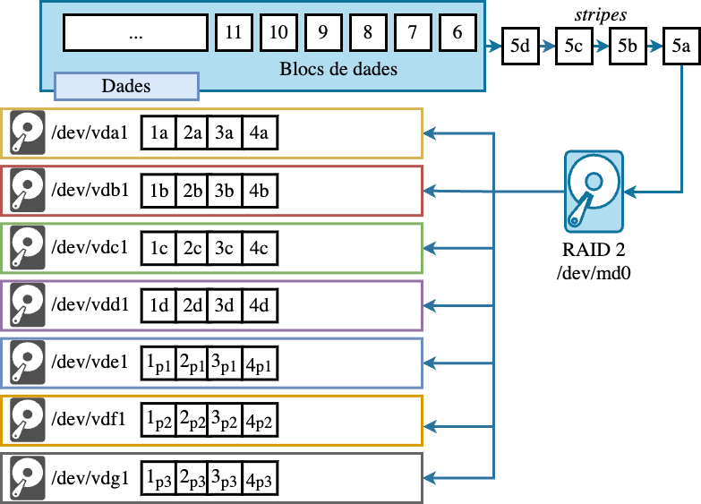
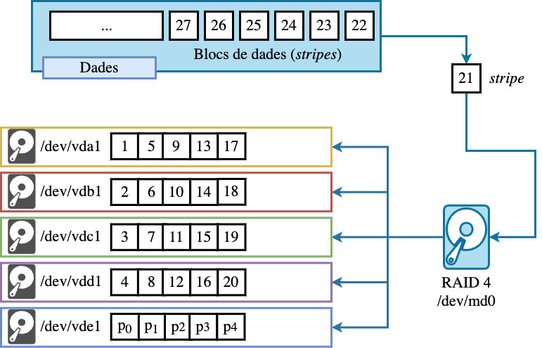
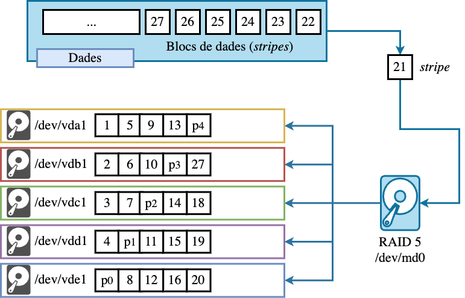
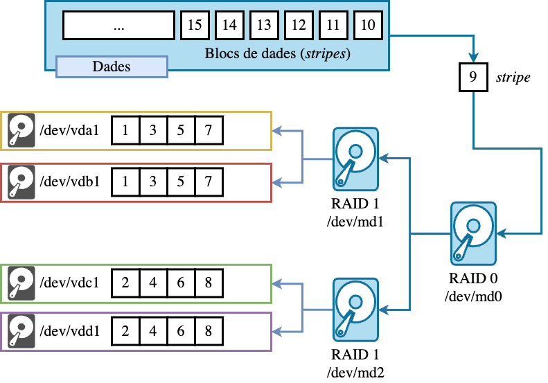
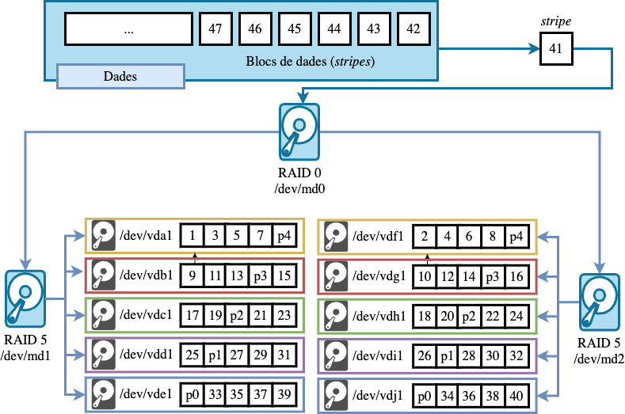

# Introducció als RAIDs

## Què és un RAID?

Un **RAID** (*Redundant Array of Independent (originalment Inexpensive) Disks*) és un conjunt de dispositius d'emmagatzematge que es combinen per a formar un sistema d'emmagatzematge únic. Aquest nou sistema d'emmagatzematge permet distribuir les dades entre els diferents dispositius que el formen i millorar-ne mètriques com la **redundància** o el **rendiment**.

::: notes
-   Els RAIDs són un conjunt de dispositius d'emmagatzematge que es combinen per a formar un sistema d'emmagatzematge únic.
-   El principal objectiu d'aquesta combinació és tolerar les fallades que es poden produir en els dispositius d'emmagatzematge. Aquesta redundància es pot aconseguir mitjançant la **duplicació** de les dades o mitjançant la **paritat**, com veurem més endavant.
-   Un altre objectiu important dels RAIDs és millorar el rendiment del sistema mitjançant la **distribució** de les dades entre els diferents dispositius. Això permet millorar la velocitat de lectura i escriptura de les dades. Es coneix també com **striping** o en altres paraules ens permet incrementar la **ample de banda**.
:::

## Què és el rendiment i la redundància?

-   La **redundància** és la capacitat d'un sistema de continuar funcionant en cas de fallada d'un o més dispositius. Aquesta capacitat es pot aconseguir mitjançant la **duplicació** de les dades o mitjançant la **paritat**.

-   El **rendiment** és la capacitat d'un sistema de processar un volum de dades en un temps determinat. Aquesta capacitat es pot aconseguir mitjançant la **distribució** de les dades entre els diferents dispositius, mitjançant una tècnica coneguda com **striping**.

## Conceptes bàsics 

-   **Redundància**: Capacitat de tolerar fallades de dispositiu (*quantitat de discs que poden fallar sense perdre dades*).
-   **Rendiment**: Mesurat en *IOPS* i ample de banda *MB/s*. Depèn de la *mida de stripe*,*nombre de discs* i *patró d'accés (seqüencial vs aleatori)*.
-   **Capacitat**: La capacitat total del sistema és la suma de les capacitats dels dispositius que el formen, tenint en compte la redundància.
-   **Stripe**: Un stripe és una unitat d'informació que es distribueix entre els diferents dispositius que formen el RAID. Conjunt de blocs distribuïts entre discs dins del RAID.
-   **Bloc**: Un bloc és una unitat d'informació que es llegeix o s'escriu en un dispositiu d'emmagatzematge. (**512B, 4KB...**).

::: {.callout-note .fragment title="Diferència entre Stripe i Bloc"}
Amb 2 dispositius i un stripe de 64 KB, cada dispositiu guarda 64 KB alternatius d’un fitxer.
:::

## Implementacions de RAIDs 

-   **Software RAID**: Implementat a nivell de sistema operatiu.
    -   **Avantatges**: flexibilitat, transparència, no depèn del hardware.
    -   **Inconvenients**: CPU utilitzat per càlculs de paritat.
-   **Hardware RAID**: Controladora dedicada (característiques pròpies, cache, acceleració XOR).
    -   **Avantatges**: millors rendiments en alguns escenaris;
    -   **Inconvenients**: dependència del controlador, propietat de metadades.
-   **Fake/BIOS RAID**: Solució mixta (*controladora amb firmware mínim*). Pot generar problemes de portabilitat i compatibilitat.

## Implementacions de RAIDs

::::: columns
::: {.column width="50%"}
{width="60%"}
:::

::: {.column width="50%"}
{width="60%"}
:::
:::::

## RAID Lineal 

`cat` lògic entre diversos dispositius d'emmagatzematge físics. **JBOD** (Just a Bunch Of Disks). No millora ni la redundància ni el rendiment.

::: {style="text-align:center"}

:::

::: notes
-   El RAID lineal és el més bàsic de tots els tipus de RAID.

-   En aquest sistema, la informació es distribueix primer en un disc i després en l'altre, seguint un ordre seqüencial. Cada unitat d'informació es coneguda com a **stripe**, i correspon a un bloc.

-   La figura mostra un exemple de RAID Lineal (/dev/md0) amb dos discos (/dev/vda i /dev/vdb). En aquest exemple s'han guardat els primers blocs (1 al 6) a la partició (/dev/vda1). Ara, s'ha d'assumir que la partició (/dev/sda1) es plena. Els següents blocs es guarden a la següent partició disponible (/dev/vdb1). I així successivament.
:::

## RAID 0 (Striping) 

:::::: columns
::: {.column width="55%"}

:::

::: {.column width="40%"}
-   **Objectiu**: augmentar rendiment i capacitat (*capacitat = suma de discos*).
-   **Mida de stripe**:
    -   Petits milloren IOPS aleatoris.
    -   Grans stripes milloren seqüencials.
-   Si les dades són prou grans, es poden llegir/escriure en paral·lel.
-   **Tolerància a fallades**: 0 (pèrdua total si un disc falla).
-   **Aplicacions**: cache, fitxers temporals, tasques on la redundància no és prioritària.
:::
::::::

::: notes
-   El nivell 0 de RAID és un dels més senzills i més utilitzats. El seu objectiu principal és millorar el rendiment del sistema mitjançant la **distribució** de les dades entre els diferents dispositius.
-   Aquesta distribució es realitza mitjançant una tècnica coneguda com **striping**. Aquesta tècnica permet dividir les dades en blocs més petits i distribuir-los entre els diferents dispositius. Fent Round Robin a tots els dispositius.
-   Això permet millorar la velocitat de lectura i escriptura de les dades, per tant incrementa l'**ample de banda**.
-   La capacitat del sistema també es veu incrementada, ja que la capacitat total del sistema és la suma de les capacitats dels dispositius que el formen.
-   El principal desavantatge del nivell 0 de RAID és que no ofereix cap tipus de redundància. Això vol dir que si un dels dispositius falla, es perden totes les dades del sistema.
-   La figura mostra un exemple de RAID0 (/dev/md0) amb dos discos (/dev/vda i /dev/vdb). En aquest exemple s’han guardat els primers blocs (1 al 6) de forma alternada 1 a cada disc. El següent bloc (9) es guarda al disc (/dev/vdb). En aquest exemple, els blocs parells es guarden al disc (/dev/vdb) i els senars al disc (/dev/vda).
:::

## RAID 1 (Mirror) 

::::: columns
::: {.column width="60%"}

:::

::: {.column width="40%"}
-   **Objectiu**: redundància via duplicació exacta (**mirrors**).
-   **Lectures**: potencialment paral·leles (millora), depèn del controlador.
-   **Escriptures**: es repliquen en tots els mirrors (overhead escritura).
-   **Capacitat usable**: 50% amb 2 discos (*en general n/2 en conjunts de mirrors*).
-   **Aplicacions**: sistema root, dades crítiques on la coherència immediata és prioritària.
:::
:::::

::: notes
-   El nivell 1 té com a objectiu principal millorar la **redundància** del sistema mitjançant la **duplicació** de les dades en dos dispositius.
-   La figura 1.3 mostra un exemple de RAID1 (/dev/md0) amb dos discos (/dev/vda i /dev/vdb). En aquest exemple s’han guardat els primers blocs (1 al 6) de forma idèntica en els dos discos. Això significa que si un dels discos falla, l’altre disc pot continuar funcionant sense interrupció, ja que conté una còpia completa de totes les dades.
-   Per tant, el principal avantatge del nivell 1 de RAID és la redundància. Això vol dir que si un dels dispositius falla, es poden recuperar les dades sense problemes.
-   Un altre avantatge del nivell 1 de RAID és que permet realitzar lectures gairebé el doble de ràpides, ja que es poden llegir les dades de forma simultània des dels dos dispositius.
-   Per contra, el nivell 1 de RAID també té alguns desavantatges. El principal desavantatge és el cost, ja que es necessiten més dispositius per a duplicar les dades. Això vol dir que el cost del sistema es duplica. A més, l’escriptura és més lenta, ja que es necessita escriure les dades en els dos dispositius de forma simultània. Finalment, la capacitat del sistema també es veu reduïda, ja que només es pot utilitzar la meitat de la capacitat total dels dispositius.
:::

## RAID 2 

::: {style="text-align:center"}
{width="60%"}
:::

-   El stripe és a nivell de **bit** i no de bloc com fins ara.
-   **Pràcticament obsolet** en sistemes moderns: exigeix molts discs i accès sincronitzat.

::: notes
-   El nivell 2 de RAID utilitza la paritat per detectar i corregir errors en les dades. Aquesta paritat es calcula mitjançant bits de control anomenats **bits de paritat**.

-   Observem que el stripe és a nivell de bit i no de bloc com fins ara. Això vol dir que les dades es divideixen en bits més petits i es distribueixen entre els diferents dispositius.

-   La Figura 1.4 mostra un exemple d’una configuració RAID 2 que implementa un codi Hamming(4,3), és a dir, 4 bits de dades i 3 bits de paritat. Aquesta configuració pot semblar poc pràctica en molts contextos, però ens proporciona una comprensió clara de com funciona la codificació de les dades i, en particular, la codificació de Hamming.

-   Els codis Hamming són una classe de codis de correcció d’errors que es basen en la paritat. Aquests codis són molt útils per a la detecció i correcció d’errors en les dades, ja que permeten identificar i corregir errors en les dades sense necessitat de retransmissió.

-   El seu ús es poc pràctic en molts contextos, ja que requereix una gran quantitat de dispositius i afegeix la complexitat de la implementació de la codificació de Hamming **(encoded)**.
:::

## Codis de Hamming 

Els codis de Hamming són una classe de codis de **correcció d’errors** que es basen en la *paritat*. Aquests codis són molt útils per a la detecció i correcció d’errors en les dades, ja que permeten identificar i corregir errors en les dades sense necessitat de retransmissió.

-   El **codi de Hamming** permet **detectar i corregir un sol error de bit**.\
-   S’utilitza en el **RAID 2** per protegir dades a nivell de bit.
-   S’intercalen bits de **paritat** entre els bits de **dades**.\
-   Cada bit de paritat comprova un conjunt específic de bits de dades.\
-   Si un bit es corromp, la combinació dels bits de paritat indica **quin bit** s’ha de corregir.

## XOR (Operació bàsica) 

La operació XOR (exclusive OR) és una operació lògica que compara dos bits i retorna un bit de resultat. El resultat és 1 si els bits comparats són diferents, i 0 si són iguals.

| A   | B   | $A \oplus B$ |
|-----|-----|:------------:|
| 0   | 0   |      0       |
| 0   | 1   |      1       |
| 1   | 0   |      1       |
| 1   | 1   |      0       |

## Hamming(7,4) -\> \[0110\] 

|       | 1     | 2     | 3     | 4     | 5     | 6     | 7     |
|-------|-------|-------|-------|-------|-------|-------|-------|
|       | $p_1$ | $p_2$ | $d_1$ | $p_3$ | $d_2$ | $d_3$ | $d_4$ |
| Dades |       |       | 0     |       | 1     | 1     | 0     |
| $p_1$ | **1** |       | 0     |       | 1     |       | 0     |
| $p_2$ |       | **1** | 0     |       |       | 1     | 0     |
| $p_3$ |       |       |       | **0** | 1     | 1     | 0     |
| Codi  | 1     | 1     | 0     | 0     | 1     | 1     | 0     |

> -   Els bits que són potència de 2 ($2^k$, k=0,1, 2…) són els bits de paritat.
> -   Bits de paritat = XOR bits de dades amb el $n^o$ de bit de paritat.

::: {style="text-align:center"}
**\[0110\]** es codifica com **\[1100110\]**
:::

## Comprovació d'errors amb Hamming \[1100110\] 

-   Es calcula els bits de **Comprovació** = XOR del bits de paritat i de tots els seus bits de dades associats:

|       | 1     | 2     | 3     | 4     | 5     | 6     | 7     |             |
|-------|-------|-------|-------|-------|-------|-------|-------|:-----------:|
|       | p$_1$ | p$_2$ | d$_1$ | p$_3$ | d$_2$ | d$_3$ | d$_4$ | Comprovació |
| Codi  | 1     | 1     | 0     | 0     | 1     | 1     | 0     |             |
| p$_1$ | 1     |       | 0     |       | 1     |       | 0     |    **0**    |
| p$_2$ |       | 1     | 0     |       |       | 1     | 0     |    **0**    |
| p$_3$ |       |       |       | 0     | 1     | 1     | 0     |    **0**    |

::: {style="text-align:center"}
Tots els **bits de comprovació = 0** → cap error detectat.
:::

## Comprovació d'errors amb Hamming \[1100111\] 

|       | 1     | 2     | 3     | 4     | 5     | 6     | 7     |             |
|-------|-------|-------|-------|-------|-------|-------|-------|:-----------:|
|       | p$_1$ | p$_2$ | d$_1$ | p$_3$ | d$_2$ | d$_3$ | d$_4$ | Comprovació |
| Codi  | 1     | 1     | 0     | 0     | 1     | 1     | **1** |             |
| p$_1$ | 1     |       | 0     |       | 1     |       | 1     |    **1**    |
| p$_2$ |       | 1     | 0     |       |       | 1     | 1     |    **1**    |
| p$_3$ |       |       |       | 0     | 1     | 1     | 1     |    **1**    |

::: {style="text-align:center"}
S'ha alterat el bit 7 corresponent a d$_4$.
:::

## Comprovació d'errors amb Hamming \[0100110\] 

|       | 1     | 2     | 3     | 4     | 5     | 6     | 7     |             |
|-------|-------|-------|-------|-------|-------|-------|-------|:-----------:|
|       | p$_1$ | p$_2$ | d$_1$ | p$_3$ | d$_2$ | d$_3$ | d$_4$ | Comprovació |
| Codi  | **0** | 1     | 0     | 0     | 1     | 1     | 0     |             |
| p$_1$ | 0     |       | 0     |       | 1     |       | 0     |    **1**    |
| p$_2$ |       | 1     | 0     |       |       | 1     | 0     |    **0**    |
| p$_3$ |       |       |       | 0     | 1     | 1     | 0     |    **0**    |

::: {style="text-align:center"}
Els bits de **comprovació = 001** → s'ha alterat el bit 1 corresponent a $p_1$.
:::

## RAID 3 i 4 

::::: columns
::: {.column width="50%"}

:::

::: {.column width="50%"}
-   **RAID 3**: striping a nivell de *byte*, paritat en disc dedicat; accés molt sincronitzat → bo per fitxers grans i seqüencials (p.ex. streaming).
-   **RAID 4**: striping a nivell de *bloc*, paritat en disc dedicat; permet accessos independents per bloc però pateix bottleneck al disc de paritat.
-   En ambdós casos la paritat dedicada pot ser coll d'ampolla per escriptura.
:::
:::::

::: notes
-   La diferència entre un RAID 3 i 4 és la granularitat de la paritat. En un RAID 3 la paritat es calcula a nivell de bytes i en un RAID 4 a nivell de blocs.
-   Les dades es distribueixen com un RAID 0 i la paritat es guarda en un disc dedicat.
-   En realitat, en un RAID 3 o 4, les dades no es dupliquen, sinó que es calcula una paritat. Si un disc falla, les dades es poden recuperar utilitzant la informació de paritat dels altres discs.
-   La figura il·lustra un exemple de configuració RAID 4. En aquest exemple, el RAID 4, identificat com a /dev/md0, està format per cinc discos: /dev/vda, /dev/vdb, /dev/vdc, /dev/vdd i /dev/vde. En aques- ta configuració RAID 4, els primers quatre discos (/dev/vda, /dev/vdb, /dev/vdc, i /dev/vdd) s’utilitzen per emmagatzemar les dades. El cin- què disc (/dev/vde) s’utilitza exclusivament per a la paritat.
:::

## RAID 5 

::::: columns
::: {.column width="50%"}

:::

::: {.column width="50%"}
-   Paritat distribuïda entre tots els discos (evita coll d'ampolla únic).
-   **Tolerància**: 1 disc (*hi ha un petit risc durant `rebuild`*). Probabilitat de fallada en discs grans.
-   **Lectura**: alta (com RAID0).
-   **Escriptura**: penalització per read-modify-write (llegir bloc antic, llegir paritat antiga, escriure dades i paritat nova). Crític per a càrregues amb moltes escriptures petites.
-   **Capacitat**: $(n-1)/n$.
-   **Aplicacions**: sistemes de fitxers, bases de dades, servidors web.
:::
:::::

::: notes
-   El RAID 5 és un dels nivells de RAID més utilitzats en els sistemes informàtics actuals. Aquest RAID ofereix un bon equilibri entre rendiment i redundància.
-   La principal diferència entre un RAID 4 i un RAID 5 és que en un RAID 5 la paritat es distribueix entre els diferents discs per evitar el coll d'ampolla.
-   La figura il·lustra un exemple de configuració RAID 5. En aquesta configuració, la paritat es distribueix entre tots els discs, en lloc de ser emmagatzemada en un disc dedicat com en el RAID 4.
:::

## RAID 6 

-   Extensió de RAID5 amb doble paritat (P i Q) → tolera 2 fallades simultànies.
-   Recomanat en conjunts grans (n gran) on la probabilitat de fallada durant rebuild és significativa.
-   Penalització d'escriptura més elevada que RAID5, però millor tolerància.

## RAID 10 

::: {style="text-align:center"}
**mirror + stripe**. Tolerància variable segons quins discs fallen; reconstrucció molt més ràpida.
:::



## RAID 50 

::: {style="text-align:center"}
**Stripe** sobre múltiples conjunts *RAID5*. Millora rendiment i tolerància depenent de cada grup.
:::



## Comparativa de RAIDs 

| Nivell | Min discs | Capacitat | Tolerància | Lectura | Escriptura |
|------------|------------|-------------|------------|------------|------------|
| RAID 0 | 2 | 100% | 0 | Alt | Alt |
| RAID 1 | 2 | 50% (amb 2 discos) | 1 per mirror | Pot ser Alt | Mitjà |
| RAID 5 | 3 | $(n-1)/n$ | 1 | Alt | Mitjà-Baix |
| RAID 6 | 4 | $(n-2)/n$ | 2 | Alt | Mitjà-Baix (pitjor que RAID5) |
| RAID 10 | 4 | 50% (depèn) | ≥1 (segons fallades) | Alt | Alt |
| RAID 50 | 6 | aproximadament $(n-1)/n$ per grup | ≥1 per grup | Alt | Mitjà |

::: notes
-   La taula mostra una comparativa entre els diferents nivells de RAID més comuns. Aquesta comparativa inclou les característiques més importants de cada RAID, com ara el nombre mínim de dispositius, la redundància, el rendiment en lectura i escriptura i la capacitat.
-   Com es pot observar, cada RAID té les seves pròpies característiques i avantatges. Per exemple, el RAID 0 ofereix un rendiment molt alt en lectura i escriptura, però no ofereix cap tipus de redundància. En canvi, el RAID 1 ofereix una alta redundància, però el rendiment en escriptura és baix.
-   Per exemple, la instal·lació d'un sistema operatiu es podria fer en un RAID 1, ja que la redundància és més important que el rendiment.
-   En canvi, un servidor web seria més adequat en un RAID 5, ja que ofereix un bon equilibri entre rendiment i redundància.
-   En general, la selecció del RAID més adequat depèn de les necessitats del sistema i dels usuaris.
:::

# RAIDs a Linux

## Dispositiu `/dev/md*` 

-   Linux implementa Software RAID mitjançant el subsistema del kernel MD (Multiple Device).
-   El mòdul principal és `md_mod`, que crea dispositius virtuals de bloc `/dev/mdX` sobre dispositius físics (`/dev/sd*`, `/dev/nvme*`, etc.).
-   Cada dispositiu MD és gestionat per un controlador de tipus `mdX` que manté una taula de mapatge (metadata) amb:
    -   nivell RAID (`level`)
    -   nombre de dispositius (`raid_disks`)
    -   superblocs (`superblock`)
    -   estat de sincronització i fallades

## Components del subsistema MD 

| Component | Funció principal |
|------------------------|------------------------------------------------|
| **md_mod** | Gestor principal del subsistema MD (creació i manteniment de /dev/mdX). |
| **raid0, raid1, raid5, raid6, raid10** | Mòduls del kernel que implementen la lògica específica de cada nivell RAID. |
| **mdadm** | Eina *user-space* que interactua amb el subsistema MD via `ioctl` i `sysfs`. |
| **/proc/mdstat** | Punt d’entrada per consultar estat de sincronització, reconstrucció i fallades. |
| **/sys/block/mdX** | Directori amb informació detallada i opcions de configuració per a cada mdX. |

## Flux d'operacions 

```{mermaid}
%%| echo: false
sequenceDiagram
    participant A as Aplicació
    participant B as Sistema de fitxers
    participant C as VFS
    participant D as /dev/mdX (md_mod)
    participant E as Driver RAIDn
    participant F as Discos físics

    A->>B: Read/Write
    B->>C: Operació de fitxer
    C->>D: Accés a /dev/mdX
    D->>E: Gestió RAID
    E->>F: Accés a discos físics
```

-   Les operacions de *paritat, mirroring o striping* s’executen al context del kernel, sovint amb tasques asíncrones (`mdX_raid_thread`).
-   Les metadades del RAID s’emmagatzemen al final (o inici) de cada disc com a superblock *MD v1.x*.
-   Des del kernel 4.0 es pot utilitzar **reshape** per canviar el nivell RAID o afegir dispositius en viu.

## Paquet `mdadm` 

En la majoria de les distribucions de Linux, el paquet `mdadm` permet la creació i gestió de dispositius RAID.

::::: columns
::: {.column width="50%"}
### Distribucions basades en Red Hat

``` bash
dnf search mdadm
```

``` bash
dnf install mdadm -y
```
:::

::: {.column width="50%"}
### Distribucions basades en Debian

``` bash
apt search mdadm
```

``` bash
apt install mdadm -y
```
:::
:::::

::: center
El funcionament del paquet `mdadm` és similar en totes les distribucions de Linux. Per tant, les instruccions d'ús són similars i no importa la distribució que s'utilitzeu.
:::

## Creació de Dispositius RAIDs 

:::::: columns
:::: {.column width="50%"}
### Opcions Bàsiques 

``` bash
mdadm --create --verbose /dev/[nom] 
--level=[nivell] 
--raid-devices=[nº dispositius] [dispositius]
```

-   **`--create`**: Crea un nou dispositiu RAID.
-   **`--verbose`**: Mostra informació detallada sobre el procés.
-   **`/dev/[nom]`**: Nom del dispositiu RAID.
-   **`--level=[nivell]`**: RAID.
-   **`--raid-devices=[nº dispositius]`**: Nombre de dispositius que formen el RAID.
-   **`[dispositius]`**: Llista de dispositius que formen el RAID.

::: {.column width="5%"}
:::
::::

::: {.column width="45%"}
### Altres Opcions

``` bash
mdadm --create --help
```

-   **`--metadata=[tipus]`**: Tipus de metadades.
-   **`--spare-devices=[nº dispositius]`**: Nombre de dispositius reservats.
-   **`--chunk=[mida]`**: Mida dels blocs.
-   **`--layout=[esquema]`**: Esquema de distribució de les dades.
:::
::::::

## Gestió del RAID `(--manage)` 

``` bash
mdadm --manage /dev/[nom] [options] [dispositius]
  --add         -a   : afegeix dispositius posteriors a l'array
  --re-add           : els dispositius posteriors són reafegits si eren
                     : membres recents de l'array
  --remove      -r   : elimina els dispositius posteriors, que no han d'estar actius
  --fail        -f   : marca els dispositius posteriors com a defectuosos
  --set-faulty       : igual que --fail
  --replace          : marca el(s) dispositiu(s) per ser reemplaçat(s) per recanvis. 
                     : Un cop completat el reemplaçament, el dispositiu es marcarà 
                     : com a defectuós
  --with             : indica quin recanvi hauria de preferir un '--replace' anterior
  --run         -R   : inicia un array parcialment construït
  --stop        -S   : desactiva l'array, alliberant tots els recursos
  --readonly    -o   : marca l'array com a només lectura
  --readwrite   -w   : marca l'array com a lectura i escriptura
```

## Informació i Monitoratge del RAID 

Les opcions `--detail` i `--examine` permeten obtenir informació detallada sobre un dispositiu RAID. La principal diferència entre ambdues opcions és que `--examine` mostra informació més detallada sobre el dispositiu.

::::: columns
::: {.column width="50%"}
``` bash
mdadm --detail /dev/[nom]
```
:::

::: {.column width="50%"}
``` bash
mdadm --examine /dev/[nom]
```
:::
:::::

La opció `--monitor` permet monitorar un dispositiu RAID en temps real. Obtenint informació sobre els esdeveniments que es produeixen en el dispositiu i ens permet prendre accions en conseqüència.

``` bash
mdadm --monitor /dev/[nom]
```

## Ensamblatge `--assemble`

-   Permet muntar un array RAID existent.
-   Aquesta opció no crea un nou array, sinó que reuneix un array existent a partir dels dispositius que especifiquem.

``` bash
mdadm --assemble /dev/[nom] [dispositius]
```

-   Cada cop que el sistema s’inicia, aquesta opció s’executa al kernel. Escaneja els discs, busca els superblocks i reconstrueix tots els arrays per a nosaltres.

## Initramfs i RAID 

En entorns amb RAID, **initramfs** inclou els binaris i la configuració necessaris per gestionar els arrays RAID. Durant la fase d'arrencada, es fa servir la comanda:

``` bash
mdadm --assemble --scan
```

Detecta i munta automàticament tots els arrays definits a `/etc/mdadm/mdadm.conf`. Això assegura que les particions RAID estiguin operatives abans de muntar la partició root i iniciar el sistema operatiu.

A més, initramfs pot incloure scripts per comprovar la integritat dels dispositius RAID i gestionar fallades de discs durant l'arrencada, assegurant un boot fiable en entorns amb mirroring (RAID1).

## Actualització amb `--grow` 

Aquesta opció permet actualitzar un dispositiu RAID. Per exemple, canviar el RAID, augmentar el nombre de dispositius o canviar la mida dels blocs.

``` bash
mdadm --grow /dev/[nom] --level=[nivell] --raid-devices=[nº dispositius]
```

-   **Situació I**: En un RAID5 format per 3 discs, ens pot interessar al cap del temps afegir un disc més.
-   **Situació II**: En un RAID5 format per 4 discs, ens pot interessar al cap del temps canviar el RAID a 6.
-   **Situació III**: En un RAID5 format per 4 discs, ens pot interessar al cap del temps canviar la mida dels blocs.

::: {.callout-important title="Compte!"}
Amb aquestes operacions, el sistema pot quedar inutilitzat. És recomanable fer una còpia de seguretat abans de realitzar aquestes operacions.
:::

## Aturar i Eliminar un RAID 

Per aturar un RAID, podem utilitzar l'opció `--stop` del mode `--manage` de `mdadm`. Aquesta opció desactiva l’array i allibera tots els recursos associats.

``` bash
mdadm --manage /dev/[nom] --stop
```

::: {.callout-important title="Compte!"}
Aquesta operació no **destruirà** l'array, sinó que simplement el desactivarà. Per eliminar un raid podem eliminar el seu dispositiu associat, sempre primer aturant l'array.

``` bash
mdadm --manage /dev/[nom] --stop
rm /dev/[nom]
```
:::

## `/etc/mdadm/mdadm.conf` 

Aquest fitxer conté informació que permet al sistema reconèixer i muntar automàticament els arrays RAID durant l’arrencada i també proporciona paràmetres per a la creació, monitorització i manteniment dels arrays.

``` text
ARRAY /dev/md0 UUID=12345678:90ab:cdef:1234:567890abcdef
ARRAY /dev/md1 UUID=abcdef12:3456:7890:abcd:ef1234567890
```

-   `ARRAY`: indica un dispositiu RAID gestionat per mdadm.
-   `/dev/mdX`: dispositiu de bloc que representa l’array RAID.
-   `UUID`: identificador únic de l’array RAID, utilitzat per assegurar que el sistema connecta correctament les particions corresponents encara que canviïn els noms dels dispositius físics (per exemple, vdb1 esdevé vdc1).

# Casos Pràctics


-   El **RAID 0** ofereix una major velocitat de lectura i escriptura, però no proporciona cap mena de redundància. Una fallada en un disc faria que es perdessin totes les dades. Per tant, no és una bona opció per a un sistema root.

-   El **RAID 1** ofereix redundància. No obstant això, no millora la velocitat d'escriptura. Aquest RAID és una bona opció per a un sistema root, ja que assegura la integritat de les dades.

## Cas Pràctic (I) 

Assumeix que vols configurar un RAID per configurar la partició *root* del teu servidor Debian. *quin RAID recomanaries i que t'aportaria?*

-   El **RAID 5**. Aquest RAID ofereix redundància i una millora en la velocitat de lectura. No obstant això, requereix un mínim de tres discs i la velocitat d'escriptura pot veure's afectada per les operacions de paritat. Aquest RAID pot ser una bona opció per a emmagatzemament de dades, però pot ser massa complex per a un sistema root.

-   **El RAID 10** combina les característiques del RAID 1 i del RAID 0, oferint tant redundància com una millora en la velocitat de lectura i escriptura. Aquest RAID pot ser una bona opció per a un sistema que requereixi un alt rendiment, però pot ser massa costós per a un sistema root.

::: notes
-   La meva recomanació és utilitzar **RAID 1** per a un sistema *root*, ja que proporciona la redundància necessària per assegurar la integritat de les dades del sistema. Si la velocitat de lectura és una preocupació, es podria considerar l'ús d'un disc SSD
:::

## Cas Pràctic (II) 

Assumeix que vols configurar un servidor amb dos discs SATA per fer renders de vídeo on l'objectiu principal es millorar el rendiment i la capacitat d'enmagatzemament temporal. *Quin RAID recomanaries?*

-   Com únicament es disposa de dos discs, el **RAID 0** seria la millor opció. Aquest RAID millora el rendiment i la capacitat d'emmagatzemament temporal, ja que les dades es divideixen i s'emmagatzemen en els dos discs de forma simultània. No obstant això, cal tenir en compte que el RAID 0 no ofereix cap mena de redundància. Per tant, si un dels discs falla, es perdran totes les dades. S'haurien de fer còpies de seguretat regulars per evitar la pèrdua de dades.

## Cas Pràctic (III) 

Assumeix un servidor de bases de dades on la integritat de les dades es crítica i les transaccions han de ser ràpides. *Quin RAID recomanaries?*

-   En aquest cas, el **RAID 10** seria la millor opció. Aquest RAID combina les característiques del RAID 1 i del RAID 0, oferint tant redundància com una millora en la velocitat de lectura i escriptura. Això és important per a un servidor de bases de dades on la integritat de les dades és crítica i les transaccions han de ser ràpides.
