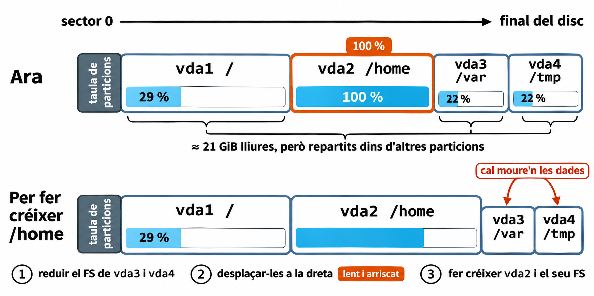
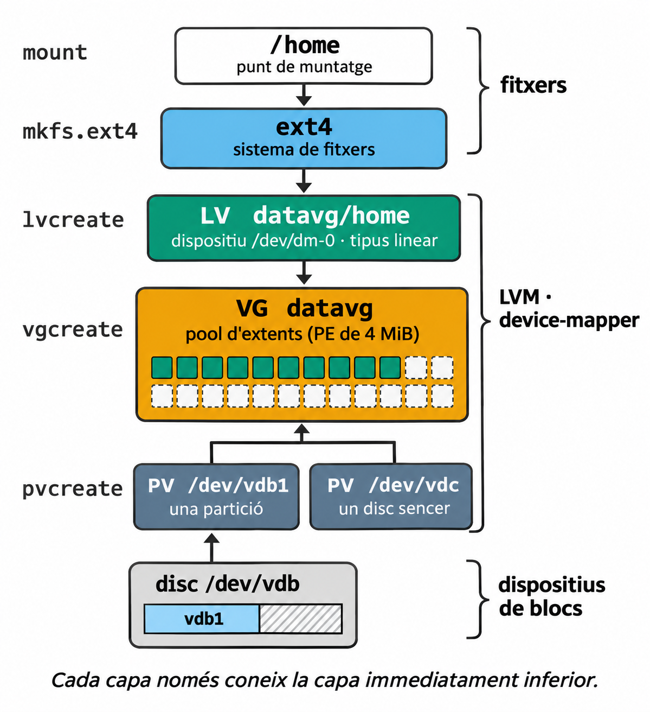
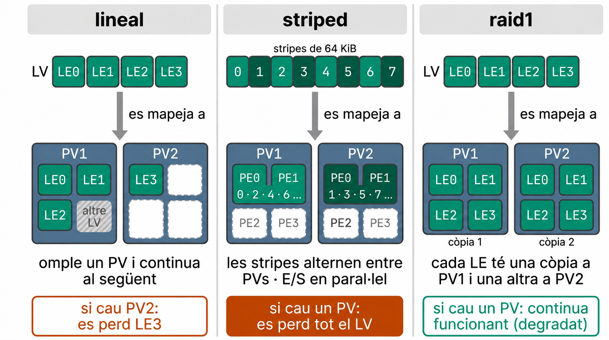
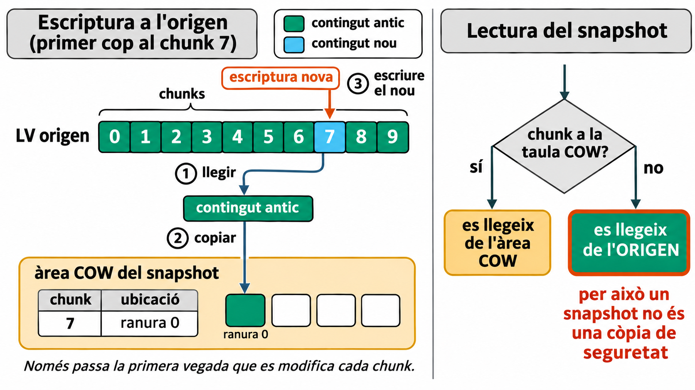
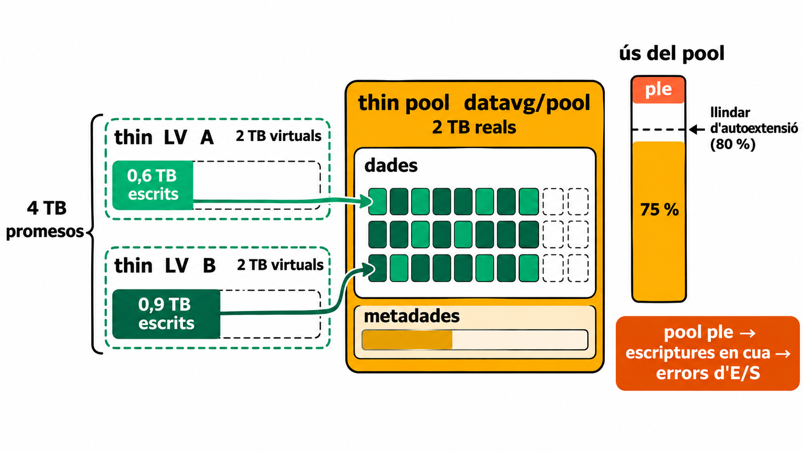

## Objectius d'aprenentatge

::: {.resultat title="En acabar aquesta sessió apendrem a..."}
-   Per què una **partició** és rígida i quina **indirecció** introdueix LVM per resoldre-ho.
-   La jerarquia **PV → VG → LV** i per què un LV és, al kernel, un dispositiu de **device-mapper**.
-   Com els **extents** i el tipus de **mapatge** (lineal, *striped*, `raid1`) determinen el rendiment i què es perd quan falla un disc.
-   Interpretar la sortida de `pvs`, `vgs` i `lvs` per identificar quins **volums lògics depenen de quins dispositius físics**.
-   En quin **ordre** cal fer les operacions per fer créixer o reduir un volum, i per què aquest ordre es dedueix del model de capes.
-   Per què un **snapshot** no és una còpia de seguretat i quin risc introdueix el **thin provisioning**.
-   On encaixa LVM en l'**arrencada**, i com es **diagnostica** l'estat d'un VG quan falla un disc abans de modificar-ne res.
:::

## On ens vam quedar?

A la Unitat 2 vam veure que l'initramfs fa, entre altres coses, això:

::: terminal
```         
... muntar el dispositiu USB, llegir la clau,
    cryptsetup luksOpen, activar LVM, muntar l'arrel ...
```
:::

::: reflexio
Què vol dir exactament **activar LVM**? Què hi ha al disc i què es crea al kernel?
:::

## El problema

Un servidor amb un disc i quatre particions:

::: terminal
``` bash        
$ df -h
Filesystem      Size  Used Avail Use% Mounted on
/dev/vda1        20G  5.5G   14G  29% /
/dev/vda2        10G  9.5G     0 100% /home
/dev/vda3       5.0G  1.0G  3.7G  22% /var
/dev/vda4       5.0G  1.0G  3.7G  22% /tmp
```
:::

::: reflexio
Hi ha uns 21 GiB lliures al disc, però `/home` està ple. Per què no els podem aprofitar?
:::

## Per què una partició és rígida

{fig-align="center" height="420px" fig-alt="Dues franges que representen el mateix disc, del sector 0 al final. A dalt, Ara: la taula de particions i quatre particions contigües, vda1 (/) al 29 %, vda2 (/home) al 100 % i marcada en vermell, i vda3 (/var) i vda4 (/tmp) al 22 %. Tres claus indiquen que els aproximadament 21 GiB lliures estan repartits dins de vda1, vda3 i vda4. A baix, Per fer créixer /home: vda1 no canvia, vda2 és més gran i ja no està plena, i vda3 i vda4 són més petites i desplaçades a la dreta, amb l'avís cal moure'n les dades. Tres passos numerats: reduir el FS de vda3 i vda4; desplaçar-les a la dreta, marcat com a lent i arriscat; fer créixer vda2 i el seu FS."}

::: concepte
Una partició és un **rang contigu de sectors**: un inici i una mida a la taula de particions. Només pot créixer directament si té **espai lliure contigu a continuació**. Si aquest espai l'ocupen altres particions, com aquí `vda3` i `vda4`, cal moure-les, i això implica **moure'n les dades**. És una operació lenta i arriscada, i sovint s'ha de fer amb el sistema aturat.
:::

## La idea: una indirecció

::: {.definicio title="LVM (Logical Volume Manager)"}
Una capa del sistema de **blocs** que reparteix l'espai de diversos dispositius en unitats petites i les **mapeja** cap a volums lògics. Al sistema de fitxers li presenta un dispositiu de blocs contigu, encara que per sota no ho sigui.
:::

::: fragment
És la mateixa idea que la **memòria virtual**: adreces lògiques contigües, blocs físics dispersos i una taula que les relaciona.
:::

:::: fragment
::: errorcomu
LVM **no és un sistema de fitxers**. No sap què és un fitxer. Per sobre d'un volum lògic cal crear un FS (`ext4`, `xfs`...), exactament com sobre una partició.
:::
::::

## El model de capes

{fig-align="center" height="600px" fig-alt="Pila vertical de capes, de dalt a baix, amb l'ordre que crea cada capa a l'esquerra: /home, punt de muntatge (mount); ext4, sistema de fitxers (mkfs.ext4); LV datavg/home, dispositiu /dev/dm-0 de tipus linear (lvcreate); VG datavg, un pool d'extents de 4 MiB on 10 extents estan assignats al LV i la resta són lliures (vgcreate); dos PV, /dev/vdb1 (una partició del disc /dev/vdb) i /dev/vdc (un disc sencer) (pvcreate). Unes claus a la dreta agrupen les capes en fitxers, LVM i device-mapper, i dispositius de blocs. Peu: cada capa només coneix la capa immediatament inferior."}

::: {.center .fragment}
**En aquest model, cada capa només coneix la capa immediatament inferior.**
:::

## PV, VG i LV

| Concepte | Què és | Exemple |
|:-----------------------|:-----------------------|:-----------------------|
| **PV** (*Physical Volume*) | Un dispositiu de blocs amb una **etiqueta i metadades LVM** | `/dev/vdb`, `/dev/vdc1`, `/dev/md0`, `/dev/mapper/cryptroot` |
| **VG** (*Volume Group*) | Un **pool** format per un o més PVs, dividit en extents | `datavg` |
| **LV** (*Logical Volume*) | Un dispositiu de blocs **retallat del VG**, on es crea el FS | `datavg/home` |

:::: fragment
::: errorcomu
*Physical* **no vol dir disc físic**. Un PV pot ser un disc sencer, una partició, un RAID de programari o un volum LUKS ja obert. L'únic requisit és que sigui un dispositiu de blocs.
:::
::::

## Un LV és un dispositiu de device-mapper

::: terminal
``` bash           
$ ls -l /dev/datavg/home /dev/mapper/datavg-home
lrwxrwxrwx 1 root root 7 ... /dev/datavg/home -> ../dm-0
lrwxrwxrwx 1 root root 7 ... /dev/mapper/datavg-home -> ../dm-0

$ sudo dmsetup table datavg-home
0 10485760 linear 254:16 2048

$ lsblk -d -o NAME,MAJ:MIN,SIZE /dev/vdb
NAME MAJ:MIN SIZE
vdb  254:16   10G
```
:::

::: concepte
Els sectors 0 a 10485759 del dispositiu `dm-0` són els sectors del dispositiu `254:16` a partir del sector 2048. La taula identifica els dispositius pel número *major:minor*, no pel nom. Aquests números s'assignen a cada sistema, i per saber a quin disc corresponen cal consultar-los amb `lsblk`: aquí, `vdb`.

Tres noms per al mateix dispositiu: `/dev/datavg/home` és el nom de **LVM** (VG/LV), `/dev/mapper/datavg-home` és el nom de **device-mapper**, i `/dev/dm-0` és el dispositiu de blocs del **kernel**. El número de `dm-N` depèn de l'ordre d'activació i pot canviar d'una arrencada a una altra; per això no es fa servir mai a `/etc/fstab`.

**Activar** un LV vol dir llegir les metadades del disc i carregar aquesta taula al kernel. És el mateix mecanisme (device-mapper) que fa servir `cryptsetup` per a LUKS.
:::

## Extents: la unitat d'assignació

-   El VG divideix cada PV en **PE** (*Physical Extents*) de mida fixa. La mida és una **propietat del VG** (`vgcreate -s`) i per defecte és de **4 MiB**.
-   Un LV és una seqüència de **LE** (*Logical Extents*) de la mateixa mida. Cada LE apunta a un PE (o a més d'un, si hi ha redundància).

:::: fragment
::: concepte
**Exemple:** amb la configuració per defecte, un PV de 10 GiB conté 2559 PE de 4 MiB, i no 2560, perquè l'inici es reserva per a l'etiqueta i les metadades. La xifra exacta depèn de l'estructura del PV. Un LV de 5 GiB té $\frac{5 GiB}{4 MiB} = 1280 LE$. Fer créixer el LV vol dir afegir LE a la llista i assignar-los PE lliures, **siguin on siguin**.
:::
::::

## Tipus de mapatge

{fig-align="center" height="380px" fig-alt="Tres panells amb dos PV cadascun. Lineal: un LV amb LE0 a LE3; PV1 conté LE0, LE1 i LE2 i un extent ocupat per un altre LV, de manera que LE3 va a PV2; si cau PV2, es perd LE3. Striped: el LV es divideix en stripes de 64 KiB numerades del 0 al 7; les parells van a PV1 (PE0 i PE1) i les senars a PV2 (PE0 i PE1); les stripes alternen entre PVs i l'E/S es fa en paral·lel; si cau un PV, es perd tot el LV. raid1: PV1 i PV2 contenen tots dos LE0, LE1, LE2 i LE3, com a còpia 1 i còpia 2; si cau un PV, el LV continua funcionant en mode degradat."}

| Tipus | Capacitat útil | Rendiment | Si cau un PV... |
|:-----------------|:-----------------|:-----------------|:-----------------|
| lineal | la suma | en cada moment s'accedeix a un sol PV | es perd el tram que hi havia; a la pràctica, el FS queda malmès |
| *striped* | la suma | E/S en paral·lel, si la càrrega ho permet | **es perd tot el LV** |
| `raid1` | la del més petit | lectures repartides entre còpies; cada escriptura va a totes dues | el LV continua funcionant (en mode degradat) |

## Comprovem-ho

::: reflexio
Teniu un VG amb 4 discos de 1 TB i hi creeu un LV *striped* de 4 TB per a una base de dades.

-   Quina és la capacitat útil? **4 TB.**
-   Quants discos han de fallar per perdre la base de dades? **Un de sol.**
-   El risc de pèrdua, ha augmentat o disminuït respecte a un sol disc? **Ha augmentat, aproximadament per quatre**: si les fallades són independents i cada disc té una probabilitat petita *p* de fallar, 1 − (1 − *p*)⁴ ≈ 4*p*.

*Striped* és una decisió de rendiment, **no de redundància**.
:::

## Crear la jerarquia

Suposem un Debian amb un segon disc buit, `/dev/vdb`:

``` bash
sudo pvcreate /dev/vdb                 # escriu l'etiqueta LVM i l'àrea de metadades
sudo vgcreate datavg /dev/vdb          # crea el pool (PE de 4 MiB per defecte)
sudo lvcreate -n home -L 5G datavg     # retalla 5 GiB → /dev/datavg/home
sudo mkfs.ext4 /dev/datavg/home        # el FS va sobre el LV, no sobre el PV
```

:::: fragment
::: errorcomu
`pvcreate` sobre un disc amb dades **les fa inaccessibles**. Comproveu-ho sempre abans amb `lsblk -f` o `wipefs /dev/vdb` (sense `-a`, només llista les signatures que hi ha). El mateix val per a `mkfs`, `lvreduce` i `pvremove`: no n'executeu cap sense haver verificat inequívocament el dispositiu.
:::
::::

## Observar l'estat

::: terminal
``` bash  
$ sudo pvs;        
PV         VG     Fmt  Attr PSize   PFree
/dev/vdb   datavg lvm2 a--  <10.00g <5.00g

$ sudo vgs;
VG     #PV #LV #SN Attr   VSize   VFree
datavg   1   1   0 wz--n- <10.00g <5.00g

$ sudo lvs;
LV   VG     Attr       LSize
home datavg -wi-a----- 5.00g
```
:::

::: concepte
`pvs`, `vgs` i `lvs` són informes configurables (`-o`, `--units`, `--reportformat json`) i són les ordres que cal fer servir en scripts. `pvdisplay`, `vgdisplay` i `lvdisplay` donen el detall en un format pensat per llegir-lo una persona.
:::

## Créixer: de baix a dalt

::: concepte
**Per fer créixer cal ampliar primer el contenidor i després el contingut.** El LV ha de ser més gran abans que el FS en pugui ocupar l'espai.
:::

::: terminal
``` bash 
sudo lvextend -r -L +2G /dev/datavg/home
```
:::

-   `-L +2G` afegeix 2 GiB al LV (a LVM, `G` vol dir GiB).
-   `-r` (`--resizefs`) fa créixer **també el FS** en el mateix pas. Delega en `fsadm`, que sap redimensionar ext2/3/4 i XFS, però no qualsevol FS.
-   Amb ext4 i XFS, el creixement es pot fer **en calent**, amb el FS muntat.

:::: fragment
::: errorcomu
Si no poseu `-r`, el LV creix però `df` continua mostrant la mida antiga. Encara caldria executar `resize2fs` (ext4) o `xfs_growfs` (XFS).
:::
::::

## Reduir: de dalt a baix

::: concepte
**Per reduir cal fer l'ordre invers: primer el contingut, després el contenidor.** Si es retalla el LV per sota de la mida del FS, se'n destrueix la part final.
:::

``` bash
sudo umount /home                          # ext4 no es pot reduir muntat
sudo lvreduce -r -L 6G /dev/datavg/home    # fsadm: amb ext4, fsck + resize2fs; després, LV
sudo mount /dev/datavg/home /home
```

-   **ext4:** es pot reduir, però només **desmuntat**.
-   **XFS:** **no es pot reduir**. L'única via és fer una còpia, recrear el FS i restaurar.

:::: fragment
::: errorcomu
`lvreduce` sense `-r` no toca el FS. Si el FS ocupava més espai que la nova mida, el resultat és un FS corrupte.
:::
::::

:::: fragment
::: bonapractica
Abans de reduir: **còpia de seguretat**, comprovació de l'espai ocupat (`df -h`) i una mida final on hi càpiga amb marge.
:::
::::

## Afegir i treure discos en calent

``` bash
sudo vgextend datavg /dev/vdc                     # afegir: el VG té més PE lliures
sudo pvs -o pv_name,pv_size,pv_used,pv_free       # hi cap a vdc el que ocupa vdb?
sudo pvmove /dev/vdb /dev/vdc                     # moure els PE ocupats de vdb a vdc
sudo lvs -a -o lv_name,devices datavg             # comprovar que ja no queda res a vdb
sudo vgreduce datavg /dev/vdb                     # treure vdb del VG
sudo pvremove /dev/vdb                            # esborrar l'etiqueta LVM
```

::: concepte
`pvmove` funciona **amb els LVs actius**. Internament crea un mirall temporal i, quan la còpia s'ha completat, actualitza el mapatge LE→PE. El FS no se n'adona, perquè el seu dispositiu (`dm-0`) no ha canviat. Aquesta és la indirecció del principi de la sessió aplicada a la pràctica.

Condició prèvia: els PVs de destinació han de tenir **prou PE lliures** per absorbir els ocupats. Indicar la destinació (`/dev/vdc`) evita que LVM triï per vosaltres. Si `pvmove` s'interromp, es reprèn executant `pvmove` sense arguments, i el PV no es pot treure fins que la migració hagi acabat.
:::

## Les metadades

-   Les **metadades** descriuen el VG: quins PVs el formen, quins LVs hi ha i el mapatge LE→PE. Són **text** i es guarden en àrees de metadades dels PVs. **Per defecte**, cada PV en té una còpia, però és configurable (`pvcreate --pvmetadatacopies` 0, 1 o 2), i un PV amb 0 no en guarda cap.
-   Cada vegada que es modifica el VG, LVM en desa una còpia a `/etc/lvm/backup/` i l'estat anterior a `/etc/lvm/archive/`.

:::{.fragment}
``` bash
sudo vgcfgbackup datavg            # desa la descripció actual
sudo vgcfgrestore --list datavg    # llista les versions arxivades
```
:::

:::: fragment
::: errorcomu
`vgcfgrestore` restaura la **descripció del VG**, no les **dades** dels volums. Restaurar unes metadades antigues sense comprovar l'estat actual dels volums pot empitjorar una incidència.
:::
::::

:::: fragment
::: reflexio
Si es perd un dels PVs d'un VG, **es perden les metadades**? Amb la configuració per defecte, **no**: els altres PVs en tenen còpia. El que es perden són les **dades** dels PE que hi havia en aquell disc.
:::
::::

## Snapshots: *copy-on-write*

{fig-align="center" height="440px" fig-alt="Dos panells. A l'esquerra, una escriptura nova al chunk 7 d'un LV origen de deu chunks. Primer es llegeix el contingut antic del chunk 7; després es copia a la ranura 0 de l'àrea COW del snapshot, on una taula registra que el chunk 7 és a la ranura 0; finalment s'escriu el contingut nou al chunk 7. Una llegenda distingeix el contingut antic, en verd, del nou, en blau. Peu: només passa la primera vegada que es modifica cada chunk. A la dreta, la lectura del snapshot: si el chunk és a la taula COW, es llegeix de l'àrea COW; si no, es llegeix de l'origen. Per això un snapshot no és una còpia de seguretat."}

::: {.definicio title="Snapshot (clàssic)"}
Un LV que representa l'estat de l'origen en un instant concret. Quan es crea no copia res. **La primera vegada** que s'escriu cada *chunk* de l'origen, el contingut antic es copia a l'àrea COW del snapshot.
:::

## Snapshots: crear, vigilar i tornar enrere

``` bash
sudo lvcreate -s -L 1G -n home-snap datavg/home           # àrea COW d'1 GiB
sudo lvs -o lv_name,lv_attr,origin,data_percent datavg    # ocupació de l'àrea COW
sudo lvconvert --merge datavg/home-snap                   # tornar l'origen a l'estat del snapshot
```

-   Si l'àrea COW arriba al **100 %**, el snapshot queda **invàlid** i inutilitzable. L'origen continua funcionant, i per això el problema pot passar desapercebut.
-   Si l'origen està **muntat**, `--merge` no fusiona res immediatament: la fusió queda **pendent fins a la propera activació** de l'origen. Si l'origen és l'arrel, això vol dir fins al proper reinici.

## Snapshots: límits

-   El snapshot **ha de ser al mateix VG** que l'origen, i els *chunks* que no han canviat **es llegeixen de l'origen**.
-   Cada snapshot actiu afegeix una còpia extra a cada primera escriptura de l'origen, i això penalitza el rendiment.
-   Quan es crea, LVM suspèn l'origen un instant i, si el FS ho admet (ext4 i XFS sí), el kernel el buida i el **congela** (*freeze*). El resultat és consistent **a nivell de FS**, però no necessàriament a nivell d'aplicació. Una base de dades pot necessitar buidar els seus *buffers* o fer servir el seu propi mecanisme de còpia.

:::: fragment
::: errorcomu
**Un snapshot no és una còpia de seguretat.** Si es perd l'origen, el snapshot no serveix per a res. El seu ús correcte és obtenir una imatge estable **de la qual fer** la còpia de seguretat, o un punt de retorn abans d'un canvi arriscat.
:::
::::

## Thin provisioning

{fig-align="center" height="400px" fig-alt="Dos thin LV, A i B, de 2 TB virtuals cadascun (4 TB promesos), dels quals només s'han escrit 0,6 TB i 0,9 TB. Les parts escrites apunten a blocs barrejats dins la zona de dades d'un thin pool datavg/pool de 2 TB reals, que també té una zona de metadades separada. Un indicador d'ús del pool marca el 75 %, per sota del llindar d'autoextensió del 80 %, amb la part superior marcada com a ple. Avís: si el pool s'omple, les escriptures queden en cua i després es produeixen errors d'E/S."}

``` bash
sudo lvcreate --type thin-pool -L 18G -n pool datavg        # espai real
sudo lvcreate --thin -V 30G -n app datavg/pool             # 30 GiB virtuals
```

::: concepte
Els thin LVs només consumeixen espai del pool quan s'hi escriu. Això permet **sobreprovisionar**: prometre més espai del que existeix. El thin provisioning **trasllada el problema de la capacitat del moment de crear el volum al moment d'escriure-hi**, i això obliga a vigilar i planificar contínuament. Els *thin snapshots* comparteixen el pool, de manera que no necessiten una àrea COW pròpia.
:::

## Quan el pool s'omple

-   Si s'esgota l'espai de **dades**, per defecte el pool posa les E/S **en cua** fins que es recupera espai o s'esgota el temps d'espera (60 segons per defecte), i després **fallen**. També es pot configurar perquè fallin immediatament (`lvcreate --errorwhenfull y`). El FS pot passar a només lectura o quedar inconsistent.
-   Les **metadades** del pool són una àrea separada. Si s'esgoten, el pool deixa d'acceptar escriptures **encara que quedin dades lliures**, i pot caldre reparar-les (`lvconvert --repair`).
-   Ampliar el **thin LV** no serveix de res: la seva mida virtual ja és gran. El que cal ampliar és el **pool**.

:::{.fragment}
``` bash
sudo lvs -a -o lv_name,lv_size,data_percent,metadata_percent datavg
```
:::

:::{.fragment}
> Cal vigilar **tots dos** percentatges.
:::

## Vigilar i ampliar el pool

::: bonapractica
Configureu l'autoextensió a `/etc/lvm/lvm.conf`, secció `activation`:

```         
thin_pool_autoextend_threshold = 80
thin_pool_autoextend_percent = 20
```

Quan el pool arriba al 80 %, el servei de monitoratge (`dmeventd`, via `lvm2-monitor.service`) l'amplia un 20 %. L'autoextensió només funciona si el pool està **monitorat** i si el **VG té espai lliure**. A més, `fstrim` pot retornar al pool els blocs que el FS ha alliberat, sempre que la cadena de dispositius propagui les operacions *discard* fins al pool.
:::

``` bash
sudo lvs -o lv_name,data_percent,metadata_percent,seg_monitor datavg   # monitored?
sudo lvextend -L +200G datavg/pool                 # ampliació manual de les dades
sudo lvextend --poolmetadatasize +1G datavg/pool   # ampliació de les metadades
```

## LVM i l'arrencada

| Partició | Sobre LVM? | Per què |
|:-----------------------|:-----------------------|:-----------------------|
| ESP (`/boot/efi`) | **Mai** | El firmware UEFI la llegeix directament com a FAT i no coneix LVM |
| `/boot` | Possible | GRUB 2 té el mòdul `lvm` i pot llegir LVs lineals. Per convenció i robustesa, se sol deixar en una partició separada |
| `/` | Habitual | L'initramfs activa el VG abans de muntar l'arrel |

:::: fragment
::: reflexio
Si `/` és un LV i l'initramfs no inclou les eines de LVM, on s'aturarà l'arrencada? **A l'initramfs: no trobarà el dispositiu arrel** (`root=`).
:::
::::

## Quan falla un disc: diagnosi

### Escenaris

| Situació | Conseqüència |
|:-----------------------------------|:-----------------------------------|
| LV sense cap extent al PV perdut | funciona amb normalitat |
| LV lineal amb part dels extents al PV perdut | inaccessible o corrupte en aquell tram |
| LV *striped* | perdut sencer |
| LV `raid1` amb una còpia sana | funciona en mode **degradat** |
| Snapshot amb l'origen o l'àrea COW al PV perdut | perdut; no serveix per recuperar res |

### Eines de diagnosi

``` bash
sudo pvs -a -o pv_name,pv_attr,pv_size,pv_free    # quin PV falta? (atribut m: missing)
sudo vgs -o vg_name,vg_attr,pv_count,lv_count     # el VG és partial (atribut p)?
sudo lvs -a -o lv_name,lv_attr,lv_size,devices    # quins LVs depenen del PV perdut?
```

## Quan falla un disc: interpretar

Un servidor arrenca i el LV `app`, de 100 GiB, no s'activa. Què **podem afirmar** amb aquesta informació? I què **no podem afirmar encara**?

::: terminal
```bash       
$ sudo pvs
  WARNING: Couldn't find device with uuid 3fKx2e-Wq8p-...
  WARNING: VG datavg is missing PV 3fKx2e-Wq8p-... (last written to /dev/vdc).
  PV         VG     Fmt  Attr PSize   PFree
  /dev/vdb   datavg lvm2 a--  <80.00g      0
  [unknown]  datavg lvm2 a-m  <60.00g <40.00g
```
---
```bash 
$ sudo lvs -a -o lv_name,lv_attr,segtype,seg_size,devices datavg
  LV   Attr       Type   SSize  Devices
  app  -wi-----p- linear 80.00g /dev/vdb(0)
  app  -wi-----p- linear 20.00g [unknown](0)
```
:::

::: fragment
| Podem afirmar | Encara no podem afirmar |
|:-----------------------------------|:-----------------------------------|
| Falta un PV (`[unknown]`, atribut `m`), que l'última vegada era `/dev/vdc` | Si el disc és mort, o només desconnectat o apagat |
| `app` és lineal: 80 GiB a `vdb` i 20 GiB al PV absent | Si les dades d'aquests 20 GiB s'han perdut |
| `app` està en estat parcial (`p`) i no es pot activar sencer | Quins fitxers estan afectats: ext4 reparteix dades i metadades per tot el volum |
:::

::: fragment
Abans de tocar les metadades, cal esbrinar què li ha passat al disc (`lsblk`, `dmesg`, el maquinari). **Si el disc torna, LVM el reconeix pel seu UUID i no s'ha perdut res.**
:::

## Quan falla un disc: recuperació

``` bash
sudo vgextend datavg /dev/vdd                             # disc nou, amb espai per a una còpia sencera
sudo lvconvert --repair datavg/db                         # raid1: refer la còpia perduda
sudo lvs -a -o lv_name,sync_percent,devices datavg        # redundància, només quan arriba al 100 %
sudo lvchange -ay --activationmode partial datavg/logs    # lineal afectat: intentar rescatar-ne dades
sudo vgreduce --removemissing --force --test datavg       # què faria? (no modifica res)
sudo vgreduce --removemissing --force datavg              # ÚLTIM pas
```

-   **Activar degradat no és reparar, i reparar no és acabar.** Un `raid1` degradat funciona sense redundància. `lvconvert --repair` necessita un PV amb prou espai per a una còpia sencera, i la redundància no torna fins que `sync_percent` arriba al **100 %**.
-   Un LV activat en mode parcial retorna errors als trams perduts. Munteu-lo **només de lectura** i copieu el que es pugui llegir.
-   `vgreduce --removemissing` refusa l'operació si encara hi ha LVs amb extents al PV perdut. Amb `--force`, **elimina aquests LVs sencers**, incloses les parts que eren en discos sans, i els snapshots que en depenen. Amb `--test`, LVM mostra què faria sense escriure res. Per això és l'últim pas, després d'haver rescatat el que es pugui; la resta s'ha de restaurar des de les còpies de seguretat.

:::: fragment
::: bonapractica
LVM aporta **flexibilitat**, no **redundància**. Si cal redundància, s'ha de demanar explícitament (`--type raid1`, o un RAID amb `mdadm`). `raid1` **tampoc no substitueix una còpia de seguretat**: replica a l'instant els esborrats, la corrupció i el *ransomware*.
:::
::::

## RAID i LVM: dues preguntes diferents

::: {.reflexio}
LVM ja pot crear volums `raid1`. Aleshores, per què existeix `mdadm`? Són alternatives, o es poden combinar?
:::

::: fragment
|  | Pregunta que respon | Propietat principal |
|:--|:--|:--|
| **RAID** | Com combino discos per obtenir rendiment i/o tolerància a fallades? | **Redundància i/o rendiment** |
| **LVM** | Com abstrec, distribueixo i reorganitzo l'espai? | **Flexibilitat** |
:::

::: fragment
::: {.concepte}
Com que no competeixen, **es poden apilar**: un RAID de `mdadm` (`/dev/md0`) pot ser el PV d'un VG. El RAID de LVM utilitza el *target* `dm-raid` de device-mapper, que **comparteix infraestructura i codi** amb el subsistema MD del kernel. No són implementacions completament independents, però sí **dues maneres diferents d'administrar RAID**, amb eines i metadades pròpies: `lvconvert --repair` i `mdadm --manage` no són intercanviables.
:::
:::

## Decisió de disseny

Quina arquitectura triaríeu per a cada cas?

::: nonincremental
1.  Un servidor de fitxers amb dos discos, on totes les dades són igual d'importants.
2.  Un servidor amb una base de dades crítica i dades temporals que es poden regenerar.
3.  Una VM en un hipervisor que ja proporciona redundància a nivell d'emmagatzematge, on no es vol duplicar aquesta protecció dins del convidat.
:::

::: fragment
| Arquitectura | Cas | Compromís |
|:-|:-|:--|
| `mdadm` → LVM → FS | 1: tot amb la mateixa protecció | Eines madures (`/proc/mdstat`, alertes de `mdadm`). LVM veu un sol PV i no sap res de la redundància |
| LVM amb RAID per LV | 2: protecció a mida (`db` en `raid1`, temporals lineals) | Un sol conjunt d'eines, però la reparació es fa LV per LV (`lvconvert --repair`) |
| LVM sense RAID | 3: la redundància ja és en una altra capa | Tota la flexibilitat, i cap protecció en aquest nivell |
:::

::: fragment
::: {.reflexio}
En el cas 2, què passa si falla el disc que conté el volum lineal de temporals? 

::: fragment
Es perden els **temporals**, però la base de dades en `raid1` continua funcionant, en mode **degradat** i fins que se'n repari la còpia. Cada volum té la seva pròpia política: el que no s'ha protegit no hereta la protecció dels altres. Només cal que el sistema no depengui dels temporals per funcionar. Per exemple, que el seu FS tingui `nofail` a `fstab`: si no en té, el sistema no arrenca.
:::
:::
:::


## Conclusions

:::: {.resum}
::: nonincremental
-   **El problema:** una partició és un rang contigu de sectors. LVM hi afegeix una indirecció, el mapatge LE→PE, de manera que l'espai lògic deixa de dependre de la posició física.
-   **Les capes:** PV → VG → LV → FS. Un LV és un dispositiu de device-mapper, i **activar-lo** vol dir carregar-ne la taula de mapatge al kernel.
-   **El mapatge decideix el risc:** un LV *striped* és més ràpid i més fràgil, i un `raid1` és redundant.
-   **L'ordre:** per créixer, primer el LV i després el FS. Per reduir, primer el FS i després el LV. XFS no es pot reduir.
-   **Snapshots i thin:** un snapshot depèn de l'origen i no és una còpia de seguretat. Un thin pool ple fa fallar les escriptures.
-   **Metadades:** per defecte n'hi ha una còpia a cada PV. `vgcfgrestore` restaura la descripció del VG, no les dades.
-   **Arrencada:** l'ESP no pot anar mai sobre LVM. L'initramfs activa el VG de l'arrel.
-   **Fallades:** primer es diagnostica i després es modifica. `raid1` sobreviu a la fallada d'un disc, però no substitueix les còpies de seguretat.
:::
::::
